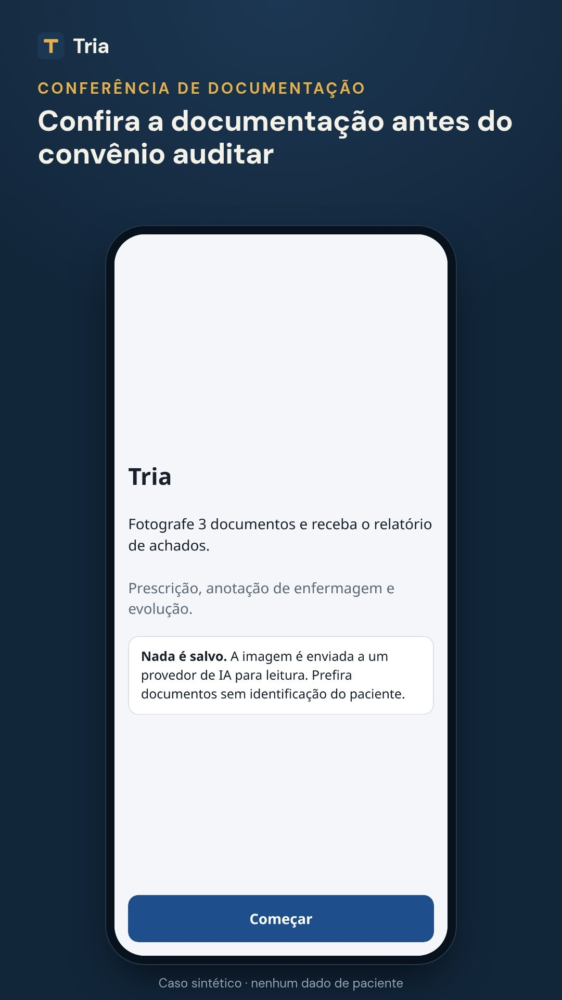
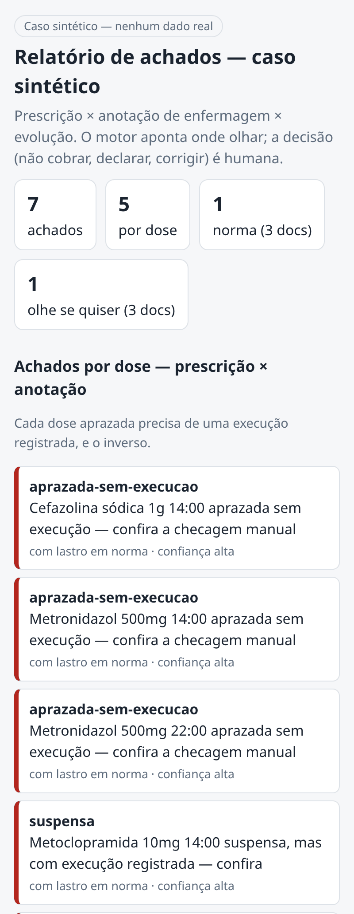

# Tria

**Confira antes. Receba pelo que fez.**

O Tria confere os documentos do hospital e mostra onde eles não batem, antes de o convênio auditar. Assim a instituição recebe pelo cuidado que já prestou.

[Página do projeto](https://tria-auditoria.vercel.app) · [Vídeo de demonstração](https://tria-auditoria.vercel.app/#video) · [O problema em detalhe](docs/problema.md) · [Testar o Tria pelo WhatsApp](https://wa.me/5588998659065?text=Ol%C3%A1%2C%20Pedro%21%20Vim%20pela%20p%C3%A1gina%20do%20Tria%20e%20quero%20testar.) · [LinkedIn do fundador](https://www.linkedin.com/in/pedro-gomes-sampaio-42539a409)

> Este repositório é a apresentação pública do Tria. O código do produto é privado.

## O problema

Glosa é quando o convênio nega ou retém o pagamento de uma conta hospitalar. Em 2024, a glosa média inicial nos hospitais privados associados à Anahp chegou a 15,89%, com mais de R$ 5,8 bilhões em serviços prestados e não pagos. Mesmo quando a glosa cai no recurso, o dinheiro fica parado de 4 a 24 meses.

Muitas glosas não questionam o cuidado, e sim o registro: o que foi prescrito, o que foi feito e o que foi anotado precisam contar a mesma história. Em dois hospitais privados estudados, a glosa administrativa respondeu por 68,7% e 78,2% do valor glosado. Conferir esses documentos à mão não dá conta de tudo: as glosas grandes são vistas, os erros pequenos passam.

→ [Leia o problema em detalhe, com as fontes](docs/problema.md)

## Como funciona

1. **Dados soltos.** O Tria recebe o documento como ele já existe. Hoje o app lê por foto de celular, e basta abrir um link: não há nada para instalar. Outros formatos (PDF, planilha, scan) entram conforme a necessidade de cada instituição.
2. **Conferência precisa.** A inteligência artificial só lê o que está escrito, linha por linha. Regras fixas cruzam os documentos entre si e mostram ao auditor onde a história não fecha, com a razão de cada achado.
3. **Valor protegido.** O relatório aponta onde olhar, tudo antes de o convênio auditar. O painel de gestão e a visão de receita em risco estão em construção.

Ao lado, o relatório real do app em um caso sintético, sem nenhum dado de paciente.

## Por que o Tria

- **Precisão.** A IA só lê; as regras decidem. Cada achado traz a razão, e a decisão final é sempre do auditor.
- **Cobertura total.** Confere todos os documentos enviados, inclusive os erros pequenos que a revisão manual não alcança.
- **Sem integração.** Funciona com o que o hospital já tem. Não depende de prontuário eletrônico nem de equipe de TI.
- **Resultado medido.** A sua auditoria confirma cada achado. O valor do Tria é medido no seu hospital, não prometido.

## Como começar

Você testa de graça, vê o resultado e decide.

1. **Testa.** Uso gratuito, com limite de uso. Você recebe um link e começa com documentos do seu hospital, sem identificação do paciente.
2. **Mede.** A sua auditoria confere e confirma os achados. Você vê, no seu próprio hospital, o que o Tria encontra.
3. **Assina.** Se o resultado valer, a assinatura é por instituição, em faixas de porte. Sem prazo fixo para decidir.

## O que o Tria confere

A administração de medicamentos é a primeira frente: cruza prescrição, anotação de enfermagem e evolução. O que a instituição precisar e ainda não existir, o Tria implementa.

| Frente | Estado |
|---|---|
| Administração de medicamentos | no ar |
| Materiais cirúrgicos | próxima |
| Exames e laudos | depois |
| Conta × prontuário | depois |
| Painel de gestão | depois |
| A sua prioridade | o que a sua instituição precisar |

## Privacidade e limites

- O Tria não guarda os documentos. A imagem é enviada a um provedor de inteligência artificial só para a leitura.
- Use documentos sem identificação do paciente: antes da foto, cubra nome, leito e número do prontuário.
- Foto desfocada é recusada antes da leitura, e linha ilegível não vira chute: o Tria avisa para conferir no papel.
- O Tria aponta onde olhar. Corrigir, deixar de cobrar ou declarar continua sendo decisão de quem audita.

## Onde estamos

O Tria está pronto para testar e busca as primeiras instituições. O app está no ar, acessado por link, e lê os documentos por foto. Até agora foi testado só em casos sintéticos.

O que vem a seguir está na tabela acima: materiais cirúrgicos, exames e laudos, conta × prontuário e painel de gestão.

## Quem faz

**Pedro Gomes Sampaio**, fundador, responsável por produto e desenvolvimento. Estudante de Ciência da Computação.

## Quer testar?

O uso é gratuito e limitado para instituições que atendem convênio. Se você trabalha com auditoria, faturamento ou gestão hospitalar, [fale comigo pelo WhatsApp](https://tria-auditoria.vercel.app/#contato) e eu envio o seu link de acesso.
